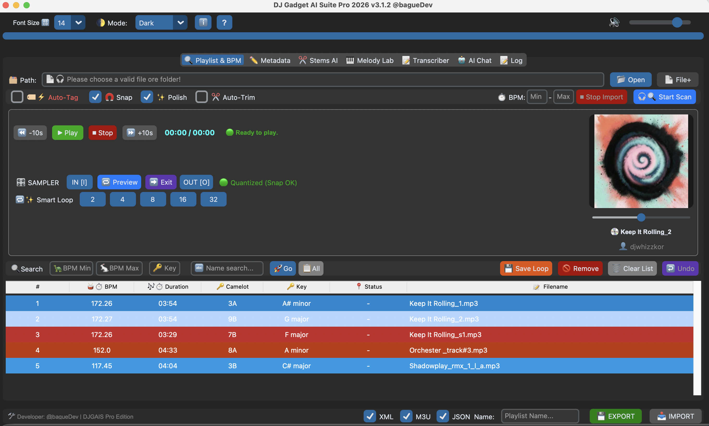
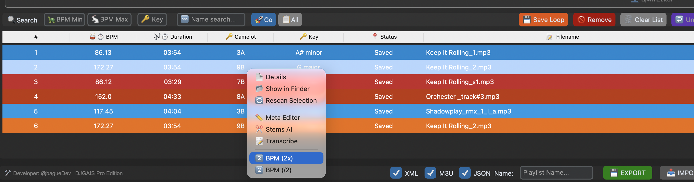
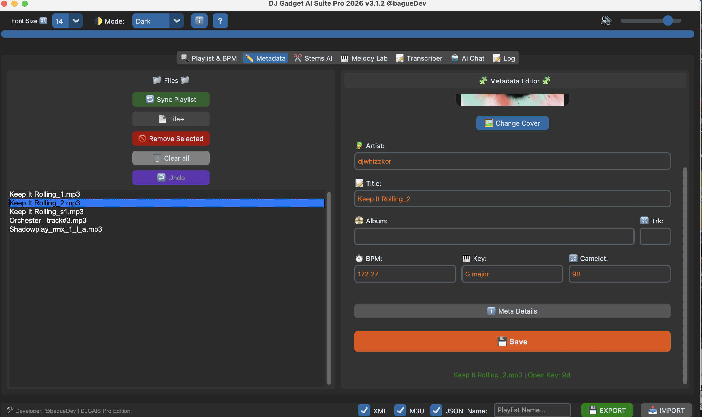
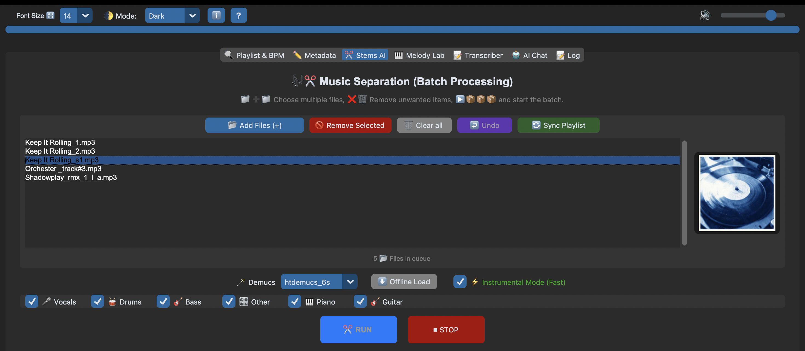
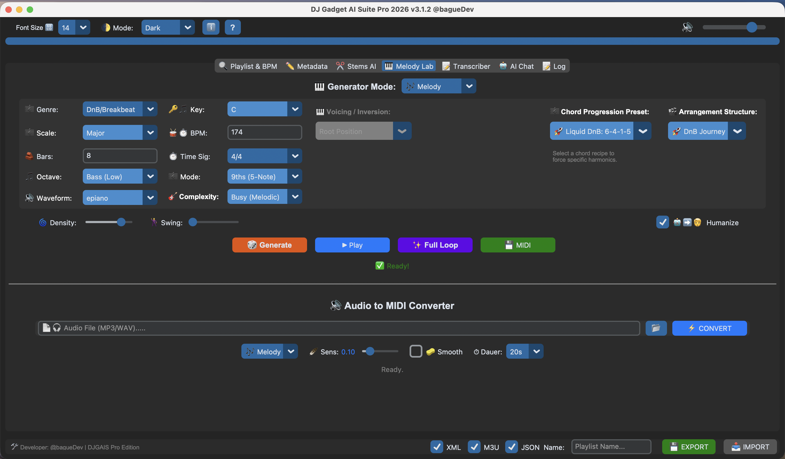
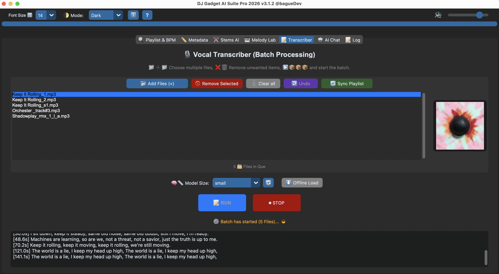
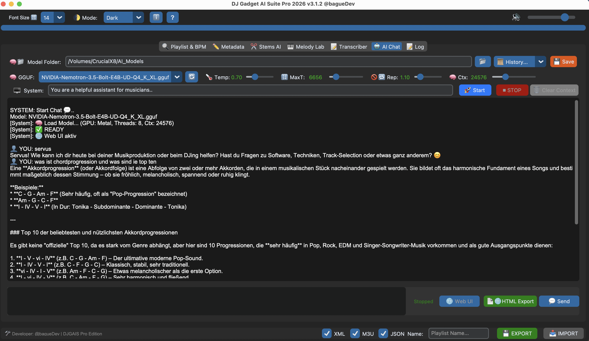

<div align="center">

# 🎧 DJ Gadget AI-Suite Pro

### Dein Player ist ein Sampler. Hören. Loopen. Zerlegen. Nachfragen.

**Die kostenlose, quelloffene KI-Workstation für DJs, Producer und Musik-Creator, die auf deinem eigenen Rechner läuft.**
Bibliothek, Sampler, Stem-Trennung, Transkription, Melodie- & MIDI-Generator und ein auf Musik getunter lokaler LLM-Chat in einer App.


[English version](README.md)

</div>



<!-- TODO: kurzes GIF einfügen: Loop setzen, während die Playlist läuft → Save Loop → WAV liegt im Ordner -->

---

## ✨ Der Workflow

Du hörst deine Playlist und plötzlich passiert *dieser* Moment. Was jetzt?

1. **Hören → schneiden.** Loop setzen, während der Track weiterläuft, einmal klicken, und ein sauberes, am Grid ausgerichtetes WAV ist gespeichert. Kein Umweg über die DAW.
2. **Zerlegen.** Rechtsklick auf den Track und direkt an Stems AI senden: Vocals, Drums, Bass, Instrumentals, auch als Batch.
3. **Nachfragen.** Du hängst fest? Frag den eingebauten, auf Musik getunten LLM-Chat.
4. **Weitergehen.** Echter Webzugriff nötig? Verbinde einen MCP-Server mit dem llama.cpp-Chat (optional).
5. **Zu MIDI machen.** Erzeuge Melodien, Akkorde und Drums im Melody Lab oder wandle ein Sample in MIDI um. Transkribiere Songtexte aus einem Song oder Video.

Alles bleibt in einer App. Tracks wandern per Rechtsklick zwischen den Tabs.

## 🎛️ Der Sampler (im Player eingebaut)

Früher: Track in die DAW laden, schneiden, Downbeat suchen, aufs Grid ziehen, Fades setzen, bouncen.
Jetzt: Loop setzen, *Save Loop* klicken, fertig.

- **IN / OUT**-Punkte, während der Track weiterläuft (Tasten `I` / `O`)
- **🧲 Snap to Beat**: magnetisches Taktgitter, Loops landen auf dem Takt
- **✂️ Auto-Trim**: etwas schief geloopt? Die Loop-Punkte werden aufs Grid angepasst
- **Smart Loops**: Loops bis 32 Takte ab der aktuellen Position
- **🔁 Preview** und **➡️ Exit Loop** (phasenrein, ohne Sprung)
- **💾 Save Loop als WAV** mit **✨ Polish**: Normalisierung + Micro-Fades (keine Klicks)

## 🧰 Die Tabs

### 🔍 Playlist & BPM Analyzer
Ordner oder einzelne Dateien scannen und **BPM, Tonart (Camelot) und Länge** erhalten. Nach BPM-Bereich, Key oder Name sortieren und filtern. Mit einem BPM-Bereich (z. B. 160–190 für DnB) vermeidest du Halftime-Fehler. Trotzdem falsch? Rechtsklick → **BPM (2x)** oder **BPM (/2)**.

> ⚠️ **Aktiviere *Auto-Tag* vor dem Scan**, wenn BPM und Key in deine Dateien geschrieben werden sollen. Es werden nur diese beiden Felder angefasst, Artist, Titel, Album und Cover bleiben erhalten.



Das Rechtsklick-Menü bietet außerdem **Details, Show in Finder, Rescan, Meta Editor, Stems AI und Transcribe**, damit Tracks ohne Neuladen zwischen den Tabs wandern.

### ✏️ Metadata Editor
Artist, Titel, Album, Tracknummer, BPM, Key und Camelot bearbeiten. Cover tauschen (auch bei WAV/AIFF), Rohdaten (Bitrate, ISRC, Encoder) über *Meta Details* ansehen, dann **Save**. Tags werden als ID3v2.3 geschrieben.



### ✂️ Stems AI
Demucs 4.1.0 mit MLX-Backend auf Apple Silicon. Vier Stems (Vocals, Drums, Bass, Other) oder **sechs Stems mit Piano und Gitarre** (`htdemucs_6s`). Mit **Instrumental-Modus**, Batch-Queue und Stem-Auswahl.



### 🎹 Melody Lab
Erzeugt **Melodien, Drums und Akkorde** als MIDI.

- 13 Genres, 19 Skalen, Key, BPM, Takte, Taktart, Oktavlage, Density, Swing, **Humanize**, Complexity
- ~40 Akkordfolgen-Presets (z. B. *Liquid DnB: 6-4-1-5*) und Arrangement-Presets (z. B. *DnB Journey*)
- **Full Loop** rendert alle Spuren auf einmal, **MIDI**-Export für jede DAW
- **Audio → MIDI**-Converter: Sample laden, Melodie oder Drums als MIDI erhalten

Die Generierung basiert auf Mustern und Musiktheorie (kein Cloud-Modell), läuft also sofort und offline.



### 📝 Transcriber
Faster-Whisper, offline. Ausgabe als `.txt` und **`.lrc`** mit Zeitstempeln. Batch-Queue. Tipp: vorher die Vocals mit Stems AI isolieren.



### 🤖 AI Chat
Beliebige GGUF-Modelle über llama.cpp (Metal-beschleunigt) mit einem Systemprompt für Musik, Verlauf, HTML-Export und der **nativen llama.cpp-Weboberfläche** im Browser.

**Optionaler Webzugriff per MCP:** Der llama.cpp-MCP-Prozess ist aktiv. Trage die URL deines eigenen MCP-Servers ein oder nutze **V.I.N.C.E.N.T.** (unser Open-Source-MCP-Server, [github.com/bagueDev](https://github.com/bagueDev)). Verbinde nur Server, denen du vertraust, denn sie geben dem Modell Werkzeuge in die Hand.



### 📝 Log
Fortschritt und Fehlermeldungen aller Worker. Der erste Blick bei Problemen.

### Export
Playlists als **Rekordbox XML**, **M3U** (Traktor / Serato / VLC) oder **JSON**.

## 🔒 Privatsphäre

- Kein Account, kein Abo, keine Telemetrie, kein Upload deiner Audiodaten.
- **Standardmäßig lokal:** Demucs (Stems), Faster-Whisper (Lyrics) und llama.cpp (Chat) laufen auf deinem Rechner.
- Modelle lädst du einmalig mit den *Offline Load*-Buttons. Danach läuft alles auch ohne WLAN (Club-Modus).
- Webzugriff gibt es nur, wenn **du** einen MCP-Server mit dem Chat verbindest.

## 💻 Voraussetzungen

- **macOS 12 (Monterey)** oder neuer
- **Apple Silicon (M1–M4):** MLX-Backend für Stems, Metal für den Chat
- **Intel-Macs:** unterstützt (CPU/Torch-Pfad, Stems brauchen länger)
- **RAM:** mindestens 8 GB, empfohlen 16 GB+
- **Speicher:** ca. 1,3 GB App, dazu die KI-Modelle, die du lädst
- Windows & Linux: geplant, noch nicht verfügbar

## 🚀 Installation

1. Neuesten Build unter **[Releases](../../releases)** herunterladen.
2. App neben den Modell-Ordnern ablegen (fehlende Ordner werden automatisch erstellt):
   ```
   DJ Gadget AI-Suite Pro.app
   AI_Models/        ← deine .gguf Chat-Modelle
   Offline_Models/   ← Demucs-Modelle
   Whisper_Models/   ← Transkriptions-Modelle
   Chat_History/     ← gespeicherte Chats
   ```
3. Erster Start: **Rechtsklick → Öffnen** und bestätigen (Gatekeeper, nur einmal). Der Start kann 10–20 s dauern, weil die Engines geprüft werden.

Es sind keine KI-Modelle enthalten. Die App ist portabel und läuft auch vom USB-Stick.

## 📖 Dokumentation

- Benutzerhandbuch: [`docs/kkommt noch`](docs/)
- Tastenkürzel: **F1** oder der **?**-Button in der App, oder das Shortcut-Cheat-Sheet als PDF in [`Shortcuts`](/SHORTCUTS.md)
- Changelog: [`CHANGELOG.md`](CHANGELOG.md)

## ⚖️ Verantwortungsvoll samplen

Sampling ist ein kreatives Werkzeug. Nutze es für eigene Musik, lizenziertes Material oder Material, an dem du die Rechte hast. Für den Umgang mit exportierten Samples bist du selbst verantwortlich.

## 🤝 Mitmachen & Support

Issues und Pull Requests sind willkommen. Bug gefunden? Eröffne ein Issue und hänge die Ausgabe des **Log**-Tabs an.

## 📜 Lizenz

Veröffentlicht unter der **GNU General Public License v3.0**, siehe [`LICENSE`](LICENSE). Du darfst den Code nutzen, untersuchen, ändern und weitergeben, abgeleitete Werke müssen aber unter derselben Lizenz offen bleiben.
Drittkomponenten (Demucs, Faster-Whisper, llama.cpp, MLX u. a.) behalten ihre eigenen Lizenzen, siehe [`THIRD_PARTY_LICENSES.md`](THIRD_PARTY_LICENSES.md). Heruntergeladene Modelle unterliegen ihren eigenen Bedingungen.

---

<div align="center">

Entwickelt von **[@bagueDev](https://github.com/bagueDev)**: DJ, Producer, Entwickler. Gemacht für Creator.

</div>
