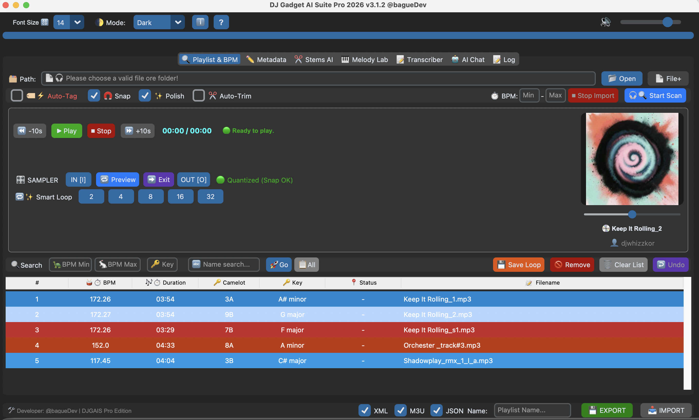
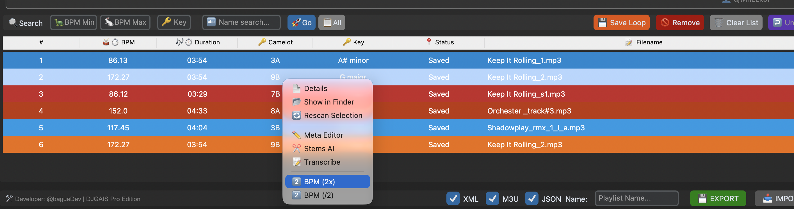
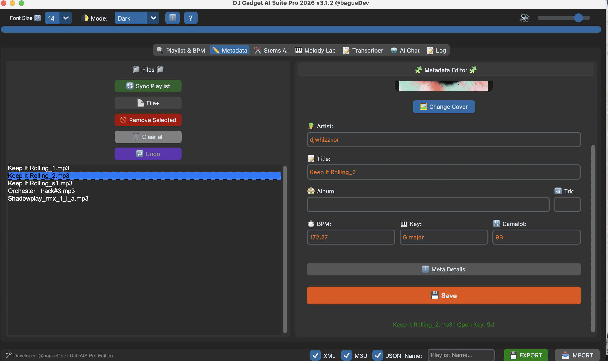
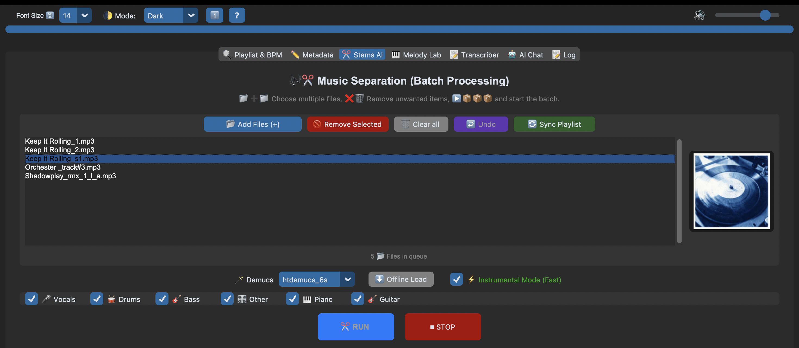
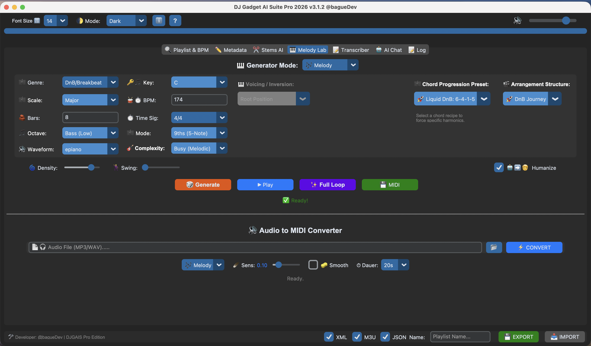
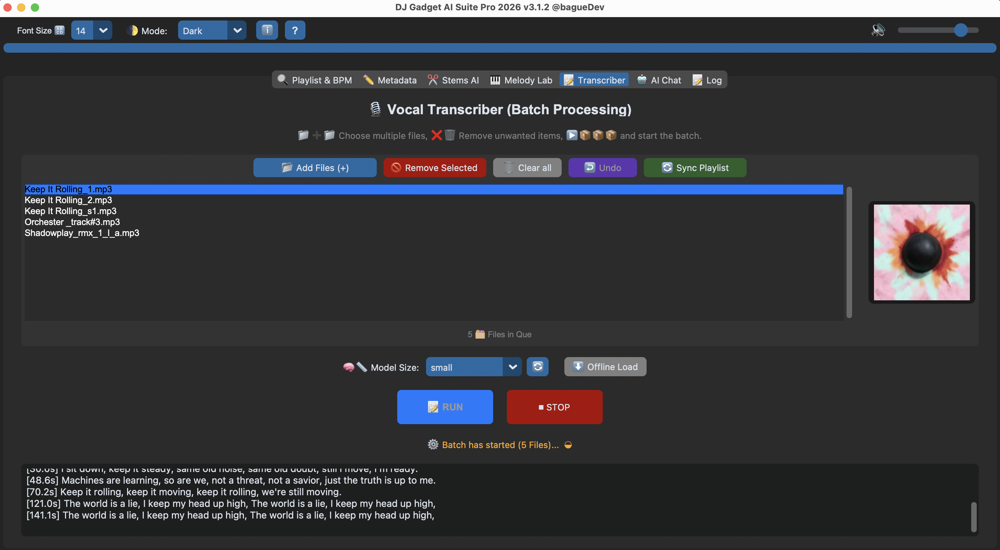
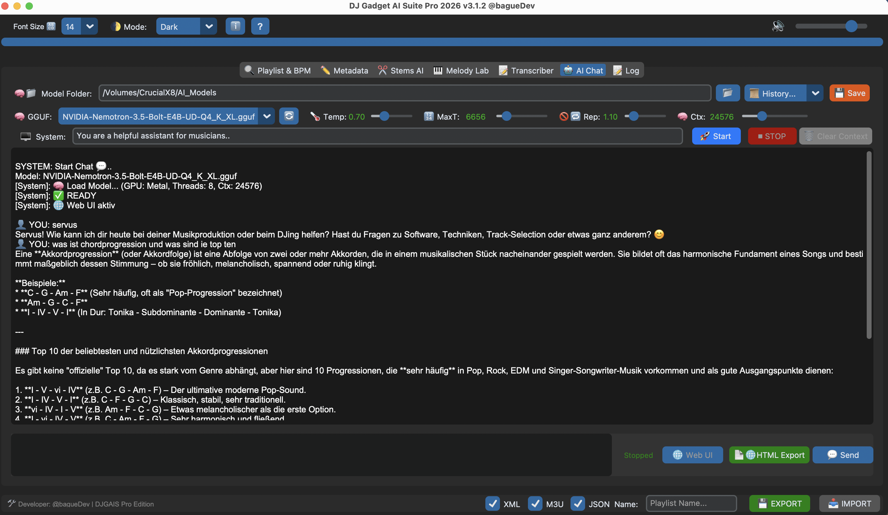

<div align="center">

# 🎧 DJ Gadget AI-Suite Pro

### Your player is a sampler. Hear it. Loop it. Split it. Ask about it.

**A free, open-source AI workstation for DJs, producers and music creators – running on your own machine.**
Library, sampler, stem separation, transcription, melody & MIDI generator and a music-tuned local LLM chat in one app.


[Deutsche Version](README.de.md)

</div>



<!-- TODO: add a short GIF: set a loop while a playlist plays → Save Loop → WAV appears -->

---

## ✨ The workflow

You are listening to your playlist and suddenly *that* moment hits. What now?

1. **Hear it → cut it.** Set a loop while the track keeps playing, click once, and a clean, grid-aligned WAV is saved. No detour through your DAW.
2. **Split it.** Right-click a track and send it straight to Stems AI: vocals, drums, bass, instrumentals – batch processing included.
3. **Ask about it.** Stuck? Ask the built-in music-tuned LLM chat.
4. **Go further.** Need real web access? Connect an MCP server to the llama.cpp chat (optional).
5. **Make it MIDI.** Generate melodies, chords and drums in the Melody Lab, or turn a sample into MIDI. Transcribe lyrics from a song or video.

Everything stays in one app. Tracks move between tabs with a right-click.

## 🎛️ The Sampler (built into the player)

Before: load the track into your DAW, cut it, find the downbeat, snap it to the grid, add fades, bounce.
Now: set the loop, click *Save Loop*, done.

- **IN / OUT** points while the track keeps playing (keys `I` / `O`)
- **🧲 Snap to Beat** – a magnetic beat grid, loops land on the bar
- **✂️ Auto-Trim** – looped a bit off? Your loop points are nudged onto the grid
- **Smart Loops** – set a loop of up to 32 bars from the current position
- **🔁 Preview** and **➡️ Exit loop** (phase-accurate, no jump)
- **💾 Save Loop as WAV** with **✨ Polish**: normalization + micro-fades (no clicks)

## 🧰 Tabs

### 🔍 Playlist & BPM Analyzer
Scan folders or single files and get **BPM, key (Camelot) and duration**. Sort and filter by BPM range, key or name. Set a BPM range (e.g. 160–190 for DnB) to avoid half-time errors. Wrong anyway? Right-click → **BPM (2x)** or **BPM (/2)**.

> ⚠️ **Tick *Auto-Tag* before scanning** if you want BPM and key written into your files. It only touches those two fields; artist, title, album and cover stay untouched.



The right-click menu also offers **Details, Show in Finder, Rescan, Meta Editor, Stems AI and Transcribe**, so tracks flow between tabs without reloading.

### ✏️ Metadata Editor
Edit artist, title, album, track number, BPM, key and Camelot. Swap cover art (also for WAV/AIFF), see raw data (bitrate, ISRC, encoder) via *Meta Details*, then **Save**. Tags are written as ID3v2.3.



### ✂️ Stems AI
Demucs 4.1.0 with an MLX backend on Apple Silicon. Four stems (vocals, drums, bass, other) or **six stems with piano and guitar** (`htdemucs_6s`). **Instrumental mode**, batch queue and per-stem selection included.



### 🎹 Melody Lab
Generates **melodies, drums and chords** as MIDI.

- 13 genres, 19 scales, key, BPM, bars, time signature, octave, density, swing, **Humanize**, complexity
- ~40 chord-progression presets (e.g. *Liquid DnB: 6-4-1-5*) and arrangement presets (e.g. *DnB Journey*)
- **Full Loop** renders all tracks at once; **MIDI** export for any DAW
- **Audio → MIDI** converter: drop in a sample, get melody or drum MIDI

Generation is pattern- and theory-based (not a cloud model), so it is instant and offline.



### 📝 Transcriber
Faster-Whisper, offline. Outputs `.txt` and **`.lrc`** with timestamps. Batch queue. Tip: isolate the vocals with Stems AI first.



### 🤖 AI Chat
Run any GGUF model through llama.cpp (Metal-accelerated) with a system prompt for music, history, HTML export and the **native llama.cpp web UI** in your browser.

**Optional web access via MCP:** the llama.cpp MCP process is active. Enter the URL of your own MCP server, or use **V.I.N.C.E.N.T.** (our open-source MCP server, [github.com/bagueDev](https://github.com/bagueDev)). Only connect servers you trust, because they give the model tools.



### 📝 Log
Progress and errors of every worker. First place to look when something goes wrong.

### Export
Playlists as **Rekordbox XML**, **M3U** (Traktor / Serato / VLC) or **JSON**.

## 🔒 Privacy

- No account, no subscription, no telemetry, no uploads of your audio.
- **Local by default:** Demucs (stems), Faster-Whisper (lyrics) and llama.cpp (chat) all run on your machine.
- Models are downloaded once with the *Offline Load* buttons. Afterwards everything works with the Wi-Fi off (club mode).
- Web access exists only if **you** connect an MCP server to the chat.

## 💻 Requirements

- **macOS 12 (Monterey)** or newer
- **Apple Silicon (M1–M4):** MLX backend for stems, Metal for chat
- **Intel Macs:** supported (CPU/Torch path, plan more time for stems)
- **RAM:** 8 GB minimum, 16 GB+ recommended
- **Disk:** ~1.3 GB app, plus the AI models you download
- Windows & Linux: planned, not available yet

## 🚀 Install

1. Download the latest build from **[Releases](../../releases)**.
2. Keep the app next to its model folders (missing folders are created automatically):
   ```
   DJ Gadget AI-Suite Pro.app
   AI_Models/        ← your .gguf chat models
   Offline_Models/   ← Demucs models
   Whisper_Models/   ← transcription models
   Chat_History/     ← saved chats
   ```
3. First launch: **right-click → Open** and confirm (Gatekeeper, only once). Startup can take 10–20 s while the engines are checked.

No AI models are included. The app is portable and also runs from a USB stick.

## 📖 Documentation

- User manual (German): [`BENUTZERHANDBUCH.md`](docs/)
- Keyboard shortcuts: press **F1** or the **?** button in the app, or see the shortcut cheat sheet PDF in [`docs/`](/)
- Changelog: [`CHANGELOG.md`](CHANGELOG.md)

## ⚖️ Responsible sampling

Sampling is a creative tool. Use it for your own music, licensed material, or material you have the rights to. You are responsible for what you do with the exported samples.

## 🤝 Contributing & support

Issues and pull requests are welcome. Found a bug? Open an issue and attach the output of the **Log** tab.

## 📜 License

Released under the **GNU General Public License v3.0**, see [`LICENSE`](LICENSE). You may use, study, modify and redistribute it, but derivative works must stay open under the same license.
Third-party components (Demucs, Faster-Whisper, llama.cpp, MLX and others) keep their own licenses, see [`THIRD_PARTY_LICENSES.md`](THIRD_PARTY_LICENSES.md). Models you download are subject to their own terms.

---

<div align="center">

Built by **[@bagueDev](https://github.com/bagueDev)**: DJ, producer, developer. Made for creators.

</div>
